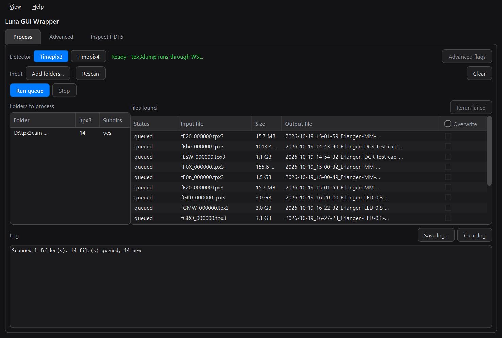

# Luna GUI Wrapper

[](https://github.com/rngKomorebi/Luna-GUI-Wrapper/actions/workflows/tests.yml)
[](LICENSE)

A desktop GUI for batch-processing Timepix3 (`.tpx3`) and Timepix4 (`.tpx4`)
raw data with ASI Luna's `tpx3dump` and `tpx4dump`. Point it at your
measurement folders: it queues every raw file, names each `.hdf5` after the
measurement it came from, runs the converter over the whole batch, and lets
you inspect the results (summary, row viewer, plots, TDC columns,
timewalk-corrected times).

> **This is only a wrapper. Luna is not included.** The project contains no
> part of Luna and cannot convert a single file by itself. You need a licensed
> Luna distribution from ASI (Amsterdam Scientific Instruments); the GUI runs
> its unmodified `tpx3dump` / `tpx4dump` as a subprocess.



## Install

You need your own Luna (the Ubuntu build, containing `bin/tpx3dump` or
`bin/tpx4dump`), Python 3.9+, and on Windows WSL with Ubuntu, since Luna is a
Linux binary.

Get the GUI in one of two ways:

- **Download a release** (no git needed): from the
  [latest release](https://github.com/rngKomorebi/Luna-GUI-Wrapper/releases/latest)
  take **Source code (tar.gz)** or **(zip)** and unpack it, e.g.

  ```bash
  tar xzf Luna-GUI-Wrapper-<version>.tar.gz
  cd Luna-GUI-Wrapper-<version>
  ```

- **Clone** the repository, for the newest code:

  ```bash
  git clone https://github.com/rngKomorebi/Luna-GUI-Wrapper
  cd Luna-GUI-Wrapper
  ```

Then, from inside that folder:

| Platform | Run once | Sets up |
|---|---|---|
| **Linux** | `sudo apt install python3-venv libxcb-cursor0`, then `bash install-linux.sh` | private venv, menu launcher, Desktop icon |
| **Windows** | `wsl --install -d Ubuntu`, then `.\install-windows.ps1` | private venv, Desktop shortcut |
| **Any** | `pip install -e ".[analysis]"` | the package and the `luna-gui-wrapper` command |

Step-by-step instructions and checks: [Installation](docs/installation.md).

## Run

Start it from the menu or Desktop shortcut, or with `./run_gui.sh` (Linux),
`run_gui.bat` (Windows) or `luna-gui-wrapper`. Then:

1. **Process** tab → **Detector**: Timepix3 or Timepix4.
2. Once per detector: **Advanced** → **Luna installation** → **Browse...** to
   your Luna folder → **Check install**.
3. **Process** → **Add folders...** → your campaign folder(s) →
   **Add to batch** → **Run queue**.

Each `.hdf5` is written next to its raw file, named for example
`2026-08-07_12-52-45_DCR-0V-gain_fCqk_000000.hdf5`. Open results on the
**Inspect HDF5** tab; press F1 for help on every option.

## Timepix3 and Timepix4

Both converters write the same datasets and columns, but not in the same units:

| | Timepix3 | Timepix4 |
|---|---|---|
| Converter, raw files | `tpx3dump`, `.tpx3` | `tpx4dump`, `.tpx4` |
| Pixels | 256 × 256 per chip | 448 × 512 |
| ToA unit | 1e-13 s | 1e-16 s |
| ToT unit (step) | ns (25 ns) | 1e-16 s (0.195 ns) |
| TDC edges, ToF, TDC columns | yes | no* |

\* Not a GUI limitation: Luna's `tpx4dump` (v0.4.4) has no
`--tof-tdc-reference` option and writes no `/TDCEvents`, so there are no
trigger edges to tag hits with. More in the
[Overview](docs/intro.md#timepix3-and-timepix4).

## Documentation

- [Overview](docs/intro.md): what it does, Timepix3 vs Timepix4, the tabs
- [Installation](docs/installation.md): Linux, Windows (WSL), from source
- [Usage](docs/usage.md): first run, worked examples, name templates
- [Inspect HDF5](docs/inspect.md): summary, row viewer, the eight plots
- [TDC](docs/tdc.md): TDC columns and reading them back from Python
- [Timewalk correction](docs/timewalk.md): corrected times without a TDC
- [Troubleshooting](docs/troubleshooting.md)
- [Contributing](docs/contribute.md) and [CONTRIBUTING.md](CONTRIBUTING.md)

## License

MIT; see [LICENSE](LICENSE). This covers the GUI only; Luna is licensed
separately by ASI. There is deliberately no bundled executable, so the GUI
cannot be passed on with Luna packed inside; see the
[licence note](docs/license.md#licence-note).

Sergei Kulkov, sergei.kulkov@fjfi.cvut.cz.
Bugs and feature requests: [GitHub issues](https://github.com/rngKomorebi/Luna-GUI-Wrapper/issues).
