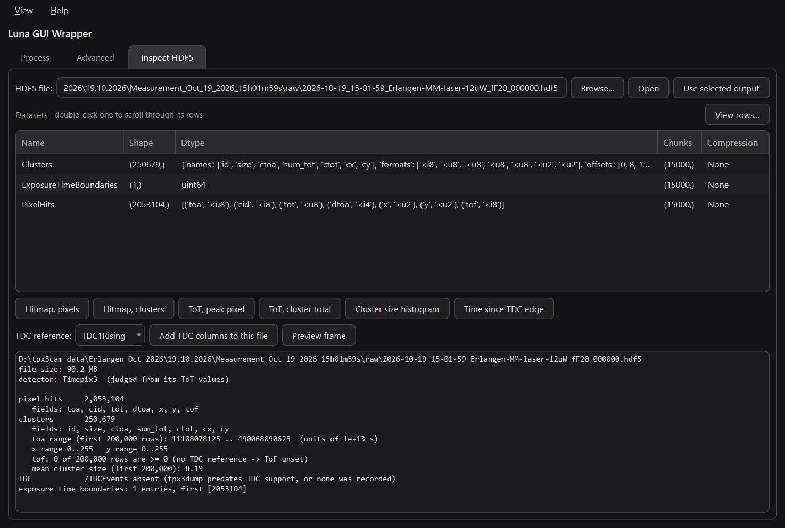
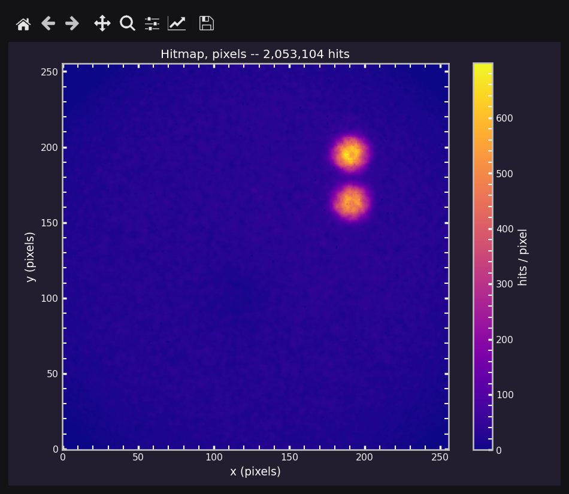
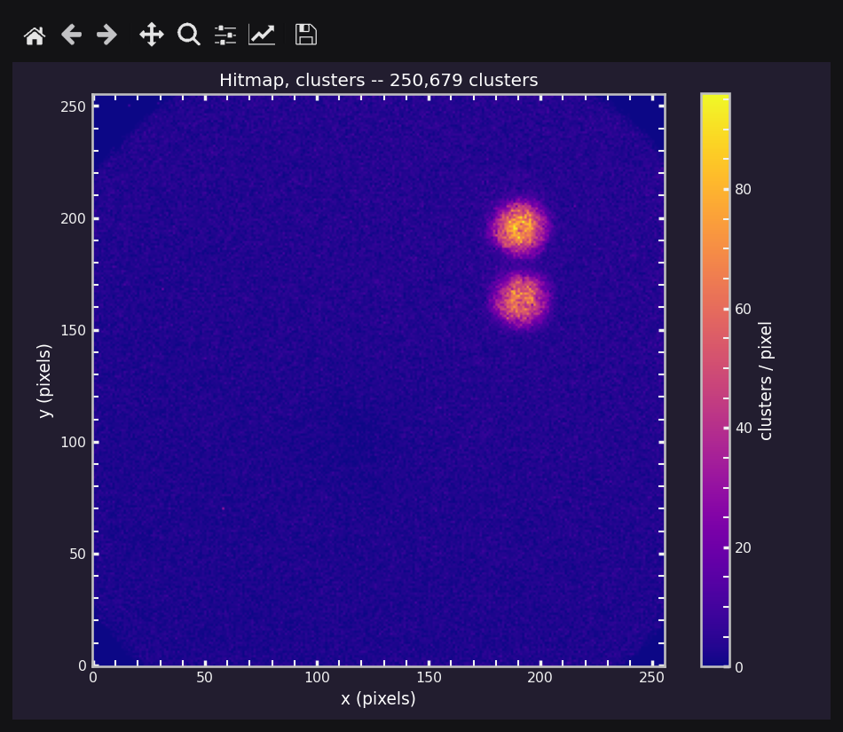
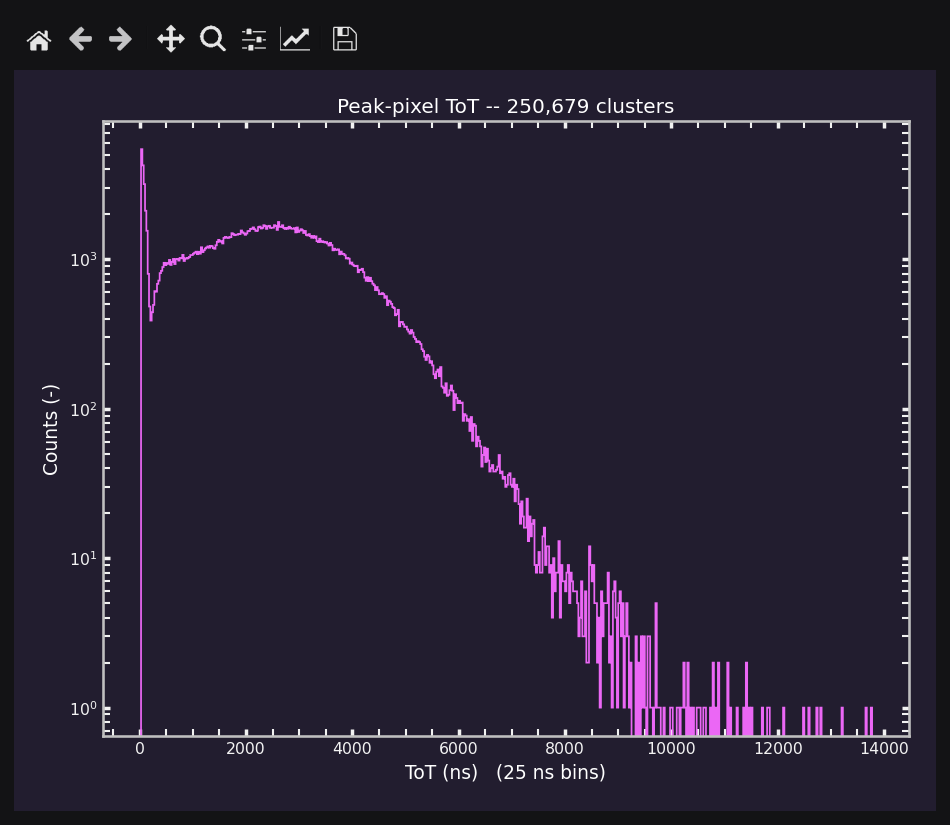
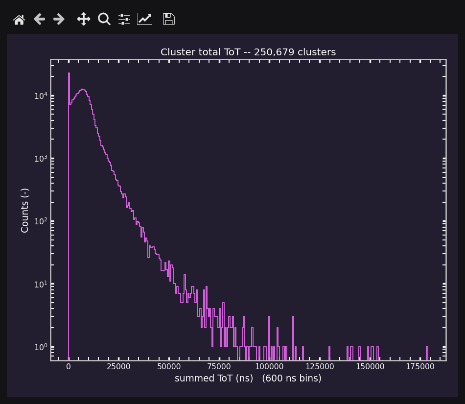
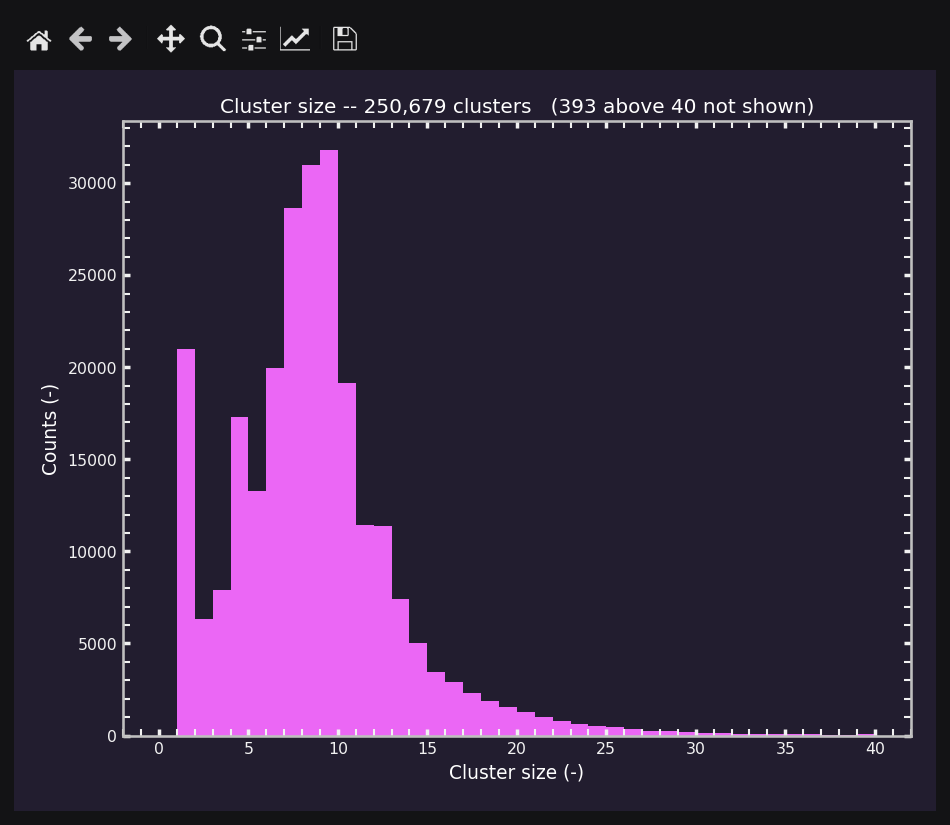

# Inspect HDF5

Open any `.hdf5` written by `tpx3dump` or `tpx4dump`. The summary lists the
datasets, row counts, ToA range and TDC edges, and says which detector the
file came from: the two are told apart by their ToT values, and each is
plotted and labelled in its own units (see
[Timepix3 and Timepix4](intro.md#timepix3-and-timepix4)).

## The eight plots

All eight read the HDF5 in slices, so multi-GB files do not exhaust memory, and
each opens in its own modeless window, so several can be compared side by side.

| Plot | Source | Binning / scale |
|---|---|---|
| **Hitmap, pixels** | `PixelHits` `x`, `y` | counts per pixel; runaway pixels kept off the colour scale |
| **Hitmap, clusters** | `Clusters` `cx`, `cy` | cluster centroids per pixel; same rule |
| **ToT, peak pixel** | `Clusters` `ctot` | one bin per ToT step on Timepix3 (25 ns), a whole number of steps on Timepix4; log y |
| **ToT, cluster total** | `Clusters` `sum_tot` | ~300 bins snapped to ToT steps, log y |
| **Cluster size histogram** | `Clusters` `size` | 40 bins over 0–40, linear y |
| **Time since TDC edge** | `Clusters` `ctoa` − `TDCEvents` | 200 bins over one trigger period, log y (Timepix3 only) |
| **Timewalk curve** | `PixelHits` `toa` − its cluster's `ctoa` | delay and jitter per 25 ns ToT bin, log y; the stored curve if its ctot cut matches, else measured from the first 8 M hits. See [Timewalk correction](timewalk.md) |
| **Time to next cluster** | `Clusters` `ctoa`, and `ctoa_tw` when the file has a timewalk correction | gap from each cluster to the next in time, over 0–1000 ns (or 3 × eps_t if longer) in bins of whole ToA steps (6.25 ns on Timepix3), log y; raw and timewalk-corrected curves overlaid, dashed line at the Advanced tab's `--eps-t` |

| | |
|---|---|
|  |  |
|  |  |
|  | |

The hitmaps are sized to the data: 256 x 256 for one Timepix3 chip, 448 x 512
for Timepix4. One hot or reference pixel can hold a third of all hits; when
the hottest pixel is more than 5x the 99.9th percentile of the pixels that
were hit, the colour scale stops at that percentile, the colour bar gets an
arrow, and the title names how many pixels were clipped and the hottest one,
for example `10 pixel(s) above the colour scale -- hottest (447, 511): 95,004`.
Hitmaps without such outliers are drawn exactly as before.

The two hitmaps answer different questions and are worth comparing: the pixel
map shows the raw illumination including cluster spread, while the cluster map
counts each event once at its centroid and so comes out visibly flatter.

The cluster size histogram is capped at 40 pixels because that is where the
distribution lives; anything above is counted and stated in the plot title
rather than dropped without saying so.

**Time to next cluster** shows how well the clustering separated events. Two
bursts closer than `--eps-t` (and `--eps-s`) are merged into one cluster, so
the histogram dips just below eps_t and the clusters that should have been
merged pile up just above it. The timewalk-corrected curve is drawn whenever
the file has a correction: `Clusters/ctoa_tw`, or computed from
`/TimewalkCurve` when only the curve was stored. The file does not record
which `--eps-t` it was processed with, so the dashed line marks the value on
the Advanced tab now (this GUI's 300 ns when the field is empty). Gaps beyond
the plotted range are counted in the title.

## The bottom panel: Summary, DCR, TDC, Timewalk

The panel under the plot buttons has four pages. The plot buttons above only
read the file; the buttons that write into it sit only on these pages, and
ask before writing.

- **Summary** is filled as soon as a file opens.
- **DCR** computes the dark count rate per pixel and per cluster on request;
  see [Dark count rate](dcr.md).
- **TDC** shows the file's TDC edges and the period of each reference.
  **Reference** sets the edge for the TDC columns and the *Time since TDC
  edge* plot; **Preview frame** and **Add TDC columns to this file** are
  described in [TDC columns](tdc.md).
- **Timewalk** shows the stored curve and corrected columns, if any. The
  **ctot cut** also sets the *Timewalk curve* plot; **Add timewalk columns to
  this file** is described in [Timewalk correction](timewalk.md).

The divider between the **Datasets** table and the plot buttons can be
dragged; the table always keeps room for the file's datasets (up to seven).

## Looking at the rows themselves

Double-click a dataset in the **Datasets** table (or select it and press
**View rows...**) to open its rows in a window of their own. It scrolls
through the whole dataset, not just the head: only the rows on screen are
read, a chunk at a time, so a 300-million-row `PixelHits` opens as fast as a
small one. **Row**, **First** and **Last** jump anywhere; the row numbers count
from 0, as h5py does. Values are shown as stored. Hover a column header for its
type and unit (on Timepix3 `toa`, `ctoa`, `tof` in 100 fs ticks and `tot` in
ns; on Timepix4 ToA and ToT both in 1e-16 s), and Ctrl+C copies the selected
cells as tab-separated text.

## ctot is the peak pixel, not the cluster total

Worth knowing before reading either ToT plot. Checked against `PixelHits` for
every one of the 692,239 clusters in a Timepix3 reference file, with no
exceptions:

| Field | What it actually holds |
|---|---|
| `ctot` | `max(tot)` over the cluster's hits: the **peak pixel** |
| `sum_tot` | `sum(tot)` over the cluster's hits: the **total** |
| `size` | number of hits in the cluster |

The giveaway is that `ctot` saturates at 14 425 ns, exactly the single-pixel
`tot` maximum. Plotted against cluster size the two behave quite differently:

| | Pearson r | median at size 1 | median at size 40 |
|---|---|---|---|
| `ctot` | 0.775 | 100 ns | 6 775 ns |
| `sum_tot` | **0.954** | 100 ns | **43 450 ns** |

`ctot` climbs steeply to about size 9 and then flattens: beyond that, extra
charge spreads into more pixels rather than driving the central one higher, so
the peak pixel saturates. `sum_tot` stays linear the whole way, as a
deposited-charge proxy should.

Use **cluster total** for deposited charge, **peak pixel** for threshold and
gain studies where the saturation is the point.

## Plot styling

The plots follow the app theme (**View** → **Theme**). The two Luna themes
use style sheets from
[komorebi_mpl](https://github.com/rngKomorebi/komorebi_mpl):

| App theme | Style | Colormap |
|---|---|---|
| Luna dark | `night_wave` | plasma |
| Luna light | `sci_pure` | cividis |

`pip install komorebi_mpl` (it is in `requirements.txt`). It is optional: if it
is not installed these themes' plots are drawn from the theme's own colours,
so nothing breaks.

The other ten themes, from daplis-rtp, draw the plots in their own colours:
figure and plot background, ticks and labels, axes frame, grid and five trace
colours, with inward ticks on all four sides. **View** → **Preferences...**
changes any of these, the plot font size and the marker size. On a Luna theme
the change is laid over the komorebi style. Hitmaps never get a grid. A theme
change applies to plots opened after it; plots already open keep their look.
