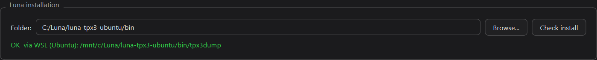

# Installation

**Before anything else, have Luna installed**: your own licensed copy from
ASI, the Ubuntu build, containing `bin/tpx3dump` (Timepix3) or `bin/tpx4dump`
(Timepix4). None of the options below provides it.

| Platform | Setup | Launch |
|---|---|---|
| **Ubuntu / Linux** | `./install-linux.sh`; see [Linux](#linux) for the full five steps | Activities menu, or `./run_gui.sh` |
| **Windows**, way 1 | install Python, WSL + Ubuntu, then `.\install-windows.ps1` once for the venv | `run_gui.bat` from PowerShell |
| **Windows**, way 2 | install Python, WSL + Ubuntu, then `.\install-windows.ps1`: builds the venv and the shortcut | double-click the Desktop shortcut |
| **Any, as a package** | `pip install -e ".[analysis]"` | `luna-gui-wrapper` |

Windows needs WSL for **every** way; see [Windows](#windows) for why.

## Requirements

```
Python 3.9+
PySide6 >= 6.5      required
h5py, numpy         optional -- Inspect tab, TDC columns
pandas              optional -- the TDC frame preview
matplotlib          optional -- the six plots
komorebi_mpl        optional -- the Luna themes' plot styles (falls back to the theme's colours)
mplcyberpunk        optional -- the glow under plot traces
```

`pip install -r requirements.txt` covers all of it; so does
`pip install -e ".[analysis,themes]"`, which also installs the app itself; see
[From source](#from-source).

## Linux

Follow these in order. Steps 1 and 2 are what people usually skip, and skipping
them gives you a launcher that installs cleanly and then does nothing when
clicked.

### 1. System packages

```bash
sudo apt install python3 python3-venv libxcb-cursor0 desktop-file-utils
```

- `libxcb-cursor0`: Qt 6.5+ will not open a window without it, and Qt's own
  error message (*"could not load the Qt platform plugin xcb"*) does not name
  the package. On a bare install you may also need `libxkbcommon-x11-0` and
  `libegl1`.
- `desktop-file-utils`: provides `desktop-file-validate`, which is how you
  check the menu entry in step 4. Not strictly required, but without it a
  malformed entry fails silently.

### 2. Install the launcher

From inside the GUI folder:

```bash
chmod +x run_gui.sh install-linux.sh
./install-linux.sh
```

With no flags that is the full install, which is what a fresh machine needs:

- a private venv with everything in `requirements.txt` (PySide6, h5py, numpy,
  pandas, matplotlib, komorebi_mpl), which `run_gui.sh` then finds on its own;
- the Activities-menu launcher;
- a double-clickable icon on the Desktop.

Everything lands under `$HOME`; no root, nothing system-wide.

| Flag | Effect |
|---|---|
| *(none)* | venv + menu launcher + Desktop icon |
| `--no-venv` | skip the venv (~450 MB, at `~/.local/share/luna-gui-wrapper/venv`) and use the system `python3`; PySide6 must already be installed, and the script warns if it is not |
| `--no-desktop-icon` | skip the icon on the Desktop; the menu launcher is still installed |
| `--uninstall` | remove the launcher, icon and desktop shortcut. Leaves the GUI's own files and the venv alone. |

`--with-venv` and `--desktop-icon` from older instructions are still accepted;
both are now the default. A launcher from before the rename (*Luna Tpx3 GUI*)
is removed.

Re-running is safe; it overwrites the entry. If you move the folder, run it
again so the launcher points at the new path.

### 3. Check it runs at all

Before worrying about the menu, prove the app itself starts:

```bash
./run_gui.sh
```

If a window opens, the launcher problem is purely a menu problem. If it does
not, you are missing PySide6 or `libxcb-cursor0`; `run_gui.sh` says which, in
a dialog if it can and on stderr regardless.

`run_gui.sh` picks its interpreter in this order: `$PYTHON`, a `.venv` beside
the script, the venv `install-linux.sh` built, then the system `python3`.

### 4. Not showing up in the applications menu?

Work down this list; each step tells you something the previous one could not.

**Is the file there?**

```bash
ls -l ~/.local/share/applications/luna-gui-wrapper.desktop
```

If it is missing, the installer failed; re-run it and read the output. It
reports the path it wrote and exits with an error if the write did not happen.

**Is it well-formed?**

```bash
desktop-file-validate ~/.local/share/applications/luna-gui-wrapper.desktop && echo VALID
```

This is the one that finds real problems. A menu silently ignores an entry it
cannot parse, which looks identical to "the menu has not refreshed yet".

**Does the menu know about it?**

```bash
update-desktop-database ~/.local/share/applications
```

**Is `$HOME/.local/share` even on the search path?**

```bash
echo "${XDG_DATA_HOME:-$HOME/.local/share}"
echo "$XDG_DATA_DIRS"
```

The installer honours `XDG_DATA_HOME`. If yours points somewhere unusual, that
is where the entry went.

**Still nothing?** Log out and back in. GNOME normally notices a new entry
within seconds, but a stuck shell needs a fresh session, and on Wayland the
old `Alt+F2` → `r` trick is not available, so logging out is the only way.

Search for **Luna**; the entry is named *Luna GUI Wrapper*.

### 5. Point it at Luna

On Linux the Luna binary runs directly (backend `native`, nothing else to set
up). Make sure it is executable:

```bash
chmod +x /path/to/luna-tpx3-.../bin/tpx3dump     # or .../bin/tpx4dump
```

Then continue with [First run](usage.md#first-run).

## Windows

### How it works, and why WSL

The Luna download is the Ubuntu build. Its binaries are Linux ELF executables:

```
bin/tpx3dump:  ELF 64-bit LSB executable, x86-64,
               interpreter /lib64/ld-linux-x86-64.so.2
```

Windows cannot run that. So the split is:

- **The GUI runs natively on Windows**, as a normal Python/Qt app.
- **The converter runs inside WSL**, launched as `wsl.exe -e /mnt/c/...`, with
  Windows paths translated to `/mnt/<drive>/...` automatically.

You never open the Ubuntu shell yourself. The GUI drives it.

Without WSL the GUI still starts and everything except *running* works: build
the queue, preview the commands, **Export .sh** to run on an Ubuntu box.

### Step 1: Python

Install Python 3.9 or newer from [python.org](https://www.python.org/downloads/),
keeping the *py launcher* option ticked. That is all you install by hand:
`.\install-windows.ps1` ([way 2](#way-2-double-click-no-terminal)) builds a
private venv at `%USERPROFILE%\venvs\luna-gui-wrapper` with everything in
`requirements.txt`, and `run_gui.bat` (way 1) uses that same venv.

To use an interpreter of your own instead, install the dependencies into it:

```powershell
py -3 -m pip install -r requirements.txt
py -3 -c "import PySide6, h5py, numpy, matplotlib; print('ok')"
```

### Step 2: install WSL and Ubuntu

In PowerShell (no administrator rights needed with current WSL):

```powershell
wsl --install -d Ubuntu
```

It downloads ~500 MB and then asks for a UNIX username and password. These are
new credentials for the Linux system, unrelated to your Windows account. On
older Windows builds WSL may ask for a reboot; current ones do not.

`Ubuntu` gives you the newest LTS. Luna for Timepix3 is built for Ubuntu
20.04, which Microsoft no longer offers, but that is fine: `tpx3dump` links
only against core glibc and libgcc

```
libgcc_s.so.1  libpthread.so.0  libm.so.6  libdl.so.2  libc.so.6
```

and glibc is forward-compatible, so a 20.04 build runs unchanged on 24.04.
**No extra `apt install` is needed.** If you would rather stay close to the
build target, `wsl --install -d Ubuntu-22.04` also works.

### Step 3: check the installation

Three checks, each answering a different question.

**Is a distribution installed and running?**

```powershell
wsl --list --verbose
```

```
  NAME      STATE      VERSION
* Ubuntu    Running    2
```

**Can WSL execute the Luna binary?** Give it the `/mnt/...` form of your own
Luna path:

```powershell
wsl -e /mnt/c/Users/<you>/path/to/luna-tpx3-.../bin/tpx3dump --version
```

```
Tpx3Dump 0.3.2
```

If that prints a version, the backend works. No `chmod +x` is needed: `/mnt/c`
is mounted with everything executable.

**Can WSL see your data?** For data on `D:`:

```powershell
wsl -e ls "/mnt/d/tpx3cam data"
```

WSL auto-mounts **fixed** disks only. A USB stick, card reader or other
removable drive never appears under `/mnt`, so the converter cannot open
anything stored on it: `tpx3dump` logs `Skipping file ... as it does not have
"Tpx3" extension and is not a directory` and then panics with `index out of
bounds: the len is 0`. The GUI checks for this before a run and offers to
mount the drive for you; the equivalent by hand, for `E:`, is

```powershell
wsl -u root -e bash -c "mkdir -p /mnt/e && mount -t drvfs E: /mnt/e"
```

No password is needed, and the mount lasts until WSL next shuts down.

**From inside the GUI:** *Advanced* tab → **Check install**. It re-detects the
backend, then runs the converter's `--version` and `process --help` and dumps
both into the log. No restart is needed after installing WSL.

A correct setup looks like this: the folder pointing at `bin/`, and a green
`OK` line naming the backend and the translated `/mnt/c/...` path:



If that line is amber or red it says why: no Luna folder set, no converter
under it, or no WSL distribution installed.

### Way 1: run it from PowerShell

```powershell
cd "C:\path\to\Luna-GUI-Wrapper"
.\run_gui.bat
```

or, from anywhere, in one line:

```powershell
& "C:\path\to\Luna-GUI-Wrapper\run_gui.bat"
```

The `&` is PowerShell's call operator, needed whenever the command is a quoted
string. The `.bat` picks its interpreter in this order: `%LUNA_PYTHON%`, a
`.venv` beside it, the venv `install-windows.ps1` builds
(`%USERPROFILE%\venvs\luna-gui-wrapper`, or `luna-tpx3-gui` from before the
rename), `%USERPROFILE%\venvs\tpx4cam`, then `py -3`. If you gave the installer
a different `-VenvName`, point `LUNA_PYTHON` at that venv's `python.exe`.

It uses `python.exe` deliberately, so a startup error stays readable in the
console. Do not close that console while the GUI is running: it kills the GUI.

### Way 2: double-click, no terminal

```powershell
.\install-windows.ps1
```

That builds a private venv with everything in `requirements.txt` at
`C:\Users\<you>\venvs\luna-gui-wrapper` (~450 MB), then creates a **Luna GUI
Wrapper** shortcut on your Desktop. Double-click it and the app starts: no
PowerShell, no `cd`, no console window, and WSL still gets driven underneath
exactly as before. No administrator rights are needed.

| Flag | Effect |
|---|---|
| *(none)* | venv + Desktop shortcut |
| `-StartMenu` | also add it to the Start Menu, so it is searchable |
| `-VenvName <name>` | build the venv at `%USERPROFILE%\venvs\<name>` instead |
| `-NoVenv` | skip the venv and use a Python that already has PySide6 (an earlier venv, `venvs\tpx4cam`, or `pythonw.exe` on `PATH`) |
| `-Python <path>` | use this specific `pythonw.exe`; implies `-NoVenv` |
| `-Uninstall` | remove the shortcuts. Leaves the GUI's own files and the venv alone. |

What it does: builds the venv from whichever Python 3.9+ the `py` launcher
finds (re-running reuses it and brings its packages up to date), checks that
the interpreter can actually `import PySide6` (this matters, since
`pythonw.exe` has no console and an import error would be silent), and writes
a `.lnk` pointing at the venv's `pythonw.exe`. A shortcut from before the
rename (*Luna Tpx3 GUI*) is removed. Right-click the shortcut → *Pin to
taskbar* if you want it permanently to hand.

After updating the GUI (a new release, or `git pull`), re-run
`.\install-windows.ps1` if `requirements.txt` changed; otherwise the shortcut
already runs the new code.

There is deliberately no standalone `.exe`; see the
[licence note](license.md).

## From source

A fresh virtual environment is recommended:

```bash
git clone https://github.com/rngKomorebi/Luna-GUI-Wrapper
cd Luna-GUI-Wrapper
python -m venv .venv
# Windows:  .venv\Scripts\activate
# Linux:    source .venv/bin/activate
pip install -e ".[analysis]"
```

Then any of these starts the GUI:

```bash
luna-gui-wrapper             # console script installed by pip
python -m luna_gui_wrapper
python src/main.py           # works without installing, given the dependencies
```

`pip install -e .` without the `[analysis]` extra installs PySide6 only:
enough to build and run batches, but the Inspect tab stays inert. `run_gui.bat`
and `run_gui.sh` pick up a `.venv` beside them automatically.
