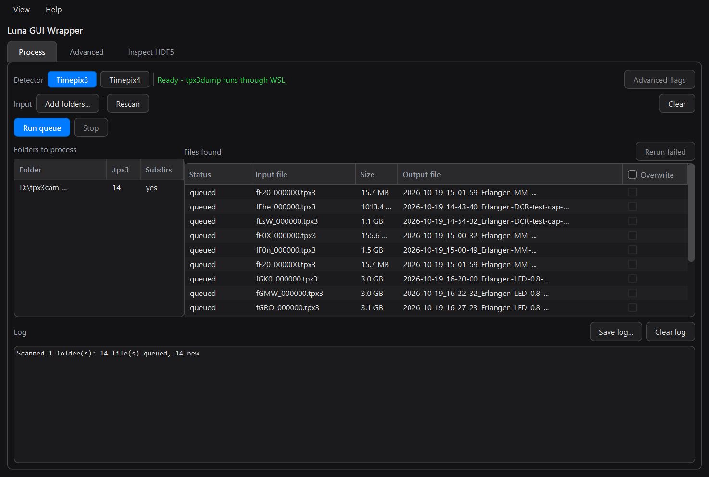

# Overview

Luna GUI Wrapper is a desktop front end for batch-processing Timepix raw data
with ASI Luna's converters: `tpx3dump` for Timepix3 `.tpx3` files and
`tpx4dump` for Timepix4 `.tpx4` files. Point it at one folder or twenty; it
finds every raw file underneath, names each output after the measurement it
came from, and runs the converter over the whole lot, instead of you typing

```bash
tpx3dump process -i INPUT_NAME.tpx3 -o OUTPUT_NAME.hdf5   # or tpx4dump ... .tpx4
```

once per file, with the right paths, the right ASI filename and the right
working directory.

```{important}
**Luna is not included.** This project is only a graphical wrapper around
ASI Luna's command-line tools; it contains no part of Luna and cannot convert
a single file by itself. You need your own licensed Luna installation from
ASI (Amsterdam Scientific Instruments). The GUI runs its **unmodified**
`tpx3dump` / `tpx4dump` as a subprocess, through the documented command-line
interface, so every `.hdf5` is exactly what the converter would have written
had you typed the command yourself.
```

| Job | Done by |
|---|---|
| Decoding raw data, clustering, writing the `.hdf5` | **Luna's `tpx3dump` / `tpx4dump`**: your copy, not shipped here |
| Finding the files, naming the outputs, queueing, running, logging | this GUI |
| Running the Linux-only converter from Windows, through WSL | this GUI |
| Reading the `.hdf5` back: summary, plots, TDC and timewalk columns | this GUI (h5py; Luna is not involved) |

Built with Qt 6 (PySide6).



## Timepix3 and Timepix4

Pick the chip with **Detector** on the Process tab. Each detector keeps its
own Luna folder and batch folders, and the Inspect tab tells the two kinds of
`.hdf5` apart by their ToT values. Both converters write the same datasets
(`PixelHits`, `Clusters`, `ExposureTimeBoundaries`) with the same columns;
what differs:

| | Timepix3 | Timepix4 |
|---|---|---|
| Luna converter, raw files | `tpx3dump`, `.tpx3` | `tpx4dump`, `.tpx4` |
| Pixels (55 µm pitch) | 256 × 256 per chip | 448 × 512 |
| ToA in the `.hdf5` | units of 1e-13 s (100 fs) | units of 1e-16 s (100 as) |
| ToT in the `.hdf5` | ns, in 25 ns steps | units of 1e-16 s, in 0.195 ns steps |
| TDC edges, ToF, TDC columns | yes | no, see below |
| Converter-only flags | `--layout`, `--n-phases`, `--tof-tdc-reference`, clustering algorithm, timewalk | `--input-format` (asi / nikhef), `--max-delay`, `--enable-gray-decoding` |

The units are those of Luna's own unit-conversion example. Code reading these
files must know which detector wrote them.

**Why no TDC on Timepix4?** It is a limit of Luna, not of this GUI. Luna
v0.4.4's `tpx4dump` has no `--tof-tdc-reference` option, and the `.hdf5` it
writes holds no `/TDCEvents`, so there are no trigger edges to compute ToF or
TDC columns from. If a later Luna adds them, the GUI's TDC tools can be enabled for
Timepix4 too. Setting up Timepix4 is in
[Usage](usage.md#9-timepix4).

## Layout

| Tab | What it is for |
|---|---|
| **Process** | The whole everyday job: pick the detector, add input, press Run, watch the log. |
| **Advanced** | Luna folder, output placement, renaming, converter flags, command preview, script export. All optional. |
| **Inspect HDF5** | Look inside a result: datasets, counts, ToA range, TDC edges, the rows themselves, eight plots, and the buttons that write the TDC and timewalk columns. See [Inspect HDF5](inspect.md). |

**Help** in the menu bar above the tabs (or F1) opens a Help window: what every
tab, option and converter flag does, the name-template placeholders, the
file's columns and units, TDC, and troubleshooting, with a Find box. Its
topics are also listed in the menu itself.

Left alone, the Process tab runs exactly

```bash
tpx3dump process -i NAME.tpx3 -o NAME.hdf5
```

per queued file (`tpx4dump` on Timepix4), writing the `.hdf5` next to its raw
file. Any deviation turns the **Advanced flags** button on the Process tab
yellow, and a click lists it all: relocation, renaming, overwriting, and every
flag passed. Silently renamed or relocated output is the one surprise worth
never having. The GUI's own post-processing (TDC columns, timewalk correction)
gets a light-green **Wrapper options** button beside it instead, shown only
while one of them is on, as it never changes the Luna command.

The **View** menu holds the theme (Luna light, Luna dark, and the ten themes
from daplis-rtp) and **Preferences...** (Ctrl+,) to change any single colour,
the font sizes and the marker size. All of it is remembered between runs.
