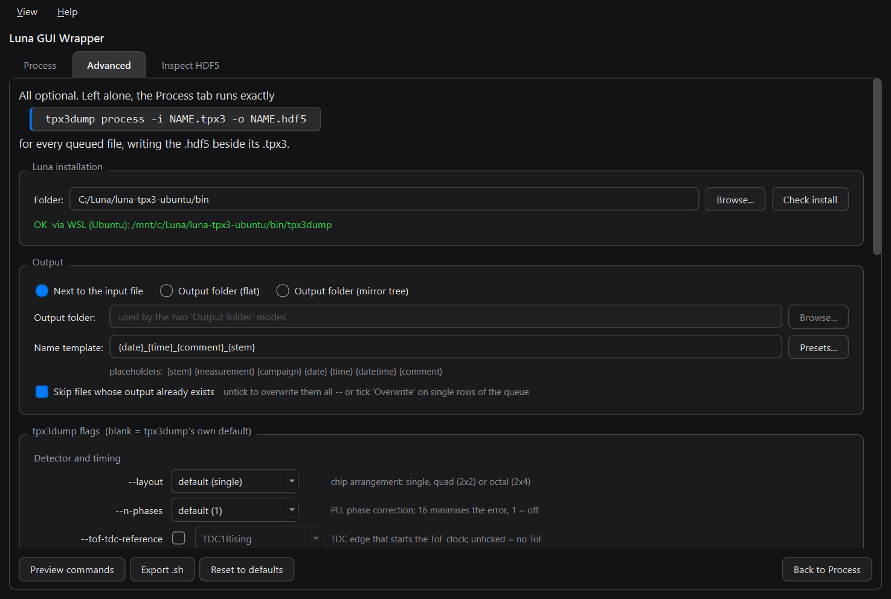

# Usage

## First run

1. On the **Process** tab, pick the **Detector**: Timepix3 or Timepix4.
2. Open the **Advanced** tab (or press *Set up Luna…* on the Process tab) and
   browse to your Luna folder: the install root, its `bin` folder, or, for
   ASI's Timepix4 archive, the outer folder that holds a same-named folder.
   It is remembered per detector, so this is a one-time step.
3. **Check install** proves the backend works and prints the authoritative flag
   list for the *extra arguments* box.
4. Back on **Process**, the status line reads *Ready* and the setup button
   disappears. From then on you never need the Advanced tab again.

Everything on the Advanced tab is optional; this is what it looks like once
Luna is configured:



## Worked examples

They all use this campaign layout, which is the one ASI's acquisition software
writes: one folder per measurement, with the metadata beside a `raw/` folder
that holds the raw file. The examples use Timepix3; Timepix4 works the same
way with `.tpx4` (see [example 9](#9-timepix4)).

```
D:\tpx3cam data\
  data_DCR_07.08.2026\
    Measurement_Aug_07_2026_12h52m45s\
      measurement_metadata.json
      comment.txt
      raw\
        fCqk_000000.tpx3
    Measurement_Aug_07_2026_13h10m02s\
      ...  raw\fDK5_000000.tpx3
    Measurement_Aug_07_2026_14h31m40s\
      ...  raw\gA7p_000000.tpx3
  data_TDC_08.08.2026\
    Measurement_Aug_08_2026_09h05m11s\
      ...  raw\hQ2m_000000.tpx3
```

### 1. Process a whole campaign folder

1. **Process** tab → **Add folders...** → **Browse...** →
   `D:\tpx3cam data\data_DCR_07.08.2026`.
2. Leave **Search subfolders** ticked (it is what reaches the `.tpx3` inside
   each `raw\`) → **Add to batch**.
3. **Run queue**.

The GUI walks the whole tree, queues every `.tpx3` it finds (`.TPX3` too), and
logs what it found:

```
Scanned 1 folder(s): 3 file(s) queued, 3 new
```

**Files found** lists each input with the output name it will get. The files
run one at a time, with the converter's own output streamed into the log. With
the default settings each `.hdf5` is written next to its raw file, named after
the measurement rather than the ASI stem:

```
Measurement_Aug_07_2026_12h52m45s\raw\
  fCqk_000000.tpx3
  2026-08-07_12-52-45_DCR-0V-gain_fCqk_000000.hdf5
```

The date, time and comment come from `measurement_metadata.json`. See
[Name templates](#name-templates) for the other fields you can use.

### 2. Many folders at once

In the same **Add folders...** dialog, click **Browse...** repeatedly, or paste
paths into the box, one per line. Explorer's *Copy as path*, quotes and all,
pastes as-is:

```
"D:\tpx3cam data\data_DCR_07.08.2026"
"D:\tpx3cam data\data_TDC_08.08.2026"
```

```
Scanned 2 folder(s): 4 file(s) queued, 4 new
```

**Folders to process** shows each folder with its raw-file count. The list is
remembered between sessions, so the next time you open the GUI the batch is
already there. A folder added twice, or a file reachable through two folders,
is queued only once. **Clear** empties the folder list and the queue.

On Windows, **Browse...** is Explorer's own folder picker, so Alt+D, pasting
into its address bar and Quick Access all work. You can also drag folders
from Explorer into the paste box.

### 3. Keep up with a live campaign: Rescan

A measurement that is still acquiring has no `measurement_metadata.json` yet,
so it can only be named after its ASI stem. Suppose one appears mid-campaign:

```
Scanned 2 folder(s): 5 file(s) queued, 1 new
    ...\Measurement_Aug_08_2026_09h20m00s\raw\hZ9x_000000.hdf5
```

Once it finishes, press **Rescan**. Rescan is a full refresh: it picks up new
files, drops queued rows whose input has since disappeared, and re-reads the
metadata for every row:

```
Scanned 2 folder(s): 5 file(s) queued, 1 metadata refresh(es)
    ...\Measurement_Aug_08_2026_09h20m00s\raw\2026-08-08_09-20-00_laser-405nm-TDC_hZ9x_000000.hdf5
```

Then **Run queue** again. Because **Skip files whose output already exists** is
on by default, the files you already processed are marked
`skipped - output exists` and only the new one runs. *Rescan, Run, repeat* is
the whole routine for a running campaign. Only run a measurement once it has
finished, so the converter never reads a half-written file.

Rows that are *running* are never touched by a rescan, because their output
path is already on the command line. Rows that are *done* or *failed* are
records of something that already happened, so a rescan never deletes them.

### 4. Collect the outputs somewhere else

By default the outputs stay beside the raw data. The **Advanced** tab →
**Output** offers two alternatives. Both need an output folder, here
`D:\processed`.

**Output folder (flat)** puts every `.hdf5` in that one folder:

```
D:\processed\
  2026-08-07_12-52-45_DCR-0V-gain_fCqk_000000.hdf5
  2026-08-07_13-10-02_DCR-0V-gain_fDK5_000000.hdf5
  2026-08-07_14-31-40_DCR-50V_gA7p_000000.hdf5
  2026-08-08_09-05-11_laser-405nm-TDC_hQ2m_000000.hdf5
```

**Output folder (mirror tree)** rebuilds the campaign structure under it,
dropping the `raw\` level, which adds nothing once the data is processed:

```
D:\processed\
  data_DCR_07.08.2026\
    Measurement_Aug_07_2026_12h52m45s\
      2026-08-07_12-52-45_DCR-0V-gain_fCqk_000000.hdf5
    ...
  data_TDC_08.08.2026\
    Measurement_Aug_08_2026_09h05m11s\
      2026-08-08_09-05-11_laser-405nm-TDC_hQ2m_000000.hdf5
```

Missing folders are created as needed. Your raw files are never moved,
renamed or modified.

If a template makes two inputs produce the same name, both rows are marked
`CLASH` and skipped rather than one overwriting the other. With
`{date}_{comment}` in flat mode, for example, `fCqk` and `fDK5` would both
become `2026-08-07_DCR-0V-gain.hdf5`. Keep `{time}` or `{stem}` in the
template to avoid this.

### 5. The same flags for the whole batch

On **Advanced** → **tpx3dump flags**, set for example `--eps-t` to `200ns` and
tick `--disable-clustering`. On the **Process** tab the **Advanced flags**
button turns from grey to yellow and reads **Advanced flags (2)**, so a
non-default run is never a surprise. Click it for the list, one setting per
row:

```
--eps-t 200ns
--disable-clustering
```

**Preview commands** prints the exact command line of every queued file
without running anything. On Windows it reads:

```
wsl.exe -e /mnt/c/Luna/luna-tpx3-ubuntu/bin/tpx3dump process -i '/mnt/d/tpx3cam data/data_DCR_07.08.2026/Measurement_Aug_07_2026_12h52m45s/raw/fCqk_000000.tpx3' -o '/mnt/d/tpx3cam data/data_DCR_07.08.2026/Measurement_Aug_07_2026_12h52m45s/raw/2026-08-07_12-52-45_DCR-0V-gain_fCqk_000000.hdf5' --eps-t 200ns --disable-clustering
```

Every `process` option of the current converter has its own control, grouped
as *Detector and timing*, *Clustering*, *Output file*, *Timewalk* and
*Performance and logging*. Each has a one-line note beside it; hover it for
the details and the converter's default. A few worth knowing:

- `--eps-t` and `--time-bin-interval` take a unit: `200ns`, `0.5s`. A bare
  number is refused before anything runs.
- `--layout` must match the detector: `single`, `quad` (2x2) or `octal` (2x4).
- Leaving `--tof-tdc-reference` unticked means no ToF at all, not a default edge.
- `--num-time-bins` and `--time-bin-interval` trade speed against memory; they
  do not change the output.
- `--raw-only` skips sorting and clustering; `--disable-clustering` still sorts.
- The Blosc compression algorithms need the `hdf5plugin` package for h5py, and
  so for the Inspect tab, to read the file. `Deflate` works anywhere.

**extra arguments** is passed verbatim after them, for anything a newer Luna
adds. **Check install** prints `process --help`, the authoritative list for
your Luna version.

### 6. Redo some files, not all

When outputs already exist, **Run queue** skips them. To redo particular
files, tick **Overwrite** on their rows in **Files found**. The checkbox in the
column header ticks or clears every row whose output exists. Untick **Skip
files whose output already exists** on the Advanced tab to overwrite
everything; **Advanced flags** then lists `OVERWRITING existing output`.

**Redo the failures.** A file that fails gets a `FAILED` line in the log with
its cause and what to change, and its row shows the cause too (hover it for
the advice). The end of the run sums the failures up by cause. Once anything
has failed, **Rerun failed (N)**, above the Overwrite column, turns yellow. It
lists each cause with the fix and warns when a cause still holds with the
current settings, for example output names still over 255 characters. It
then ticks **Overwrite** where a failed run left a partial `.hdf5` and runs
the failed files only; every other row is left alone.

The log is kept whole for the session, however long the batch. **Save
log...** writes it to a text file.

### 7. Build the batch on Windows, run it on a Linux machine

For a long campaign, you may prefer to run on a Linux workstation or server.
Build the queue as usual, then **Advanced** → **Export .sh**. You get a
self-contained script with your paths translated, your flags applied, and
the input and output roots pulled out into variables to edit on the other
machine:

```bash
#!/usr/bin/env bash
# Generated by Luna GUI Wrapper -- run this on the Linux machine.
#
# 1. Put the Luna bin/ directory on PATH, or set TPX3DUMP below
#    to the absolute path of the tpx3dump executable.
# 2. Edit IN_ROOT / OUT_ROOT to match where the data lives there.
set -euo pipefail

TPX3DUMP=${TPX3DUMP:-tpx3dump}
IN_ROOT='/mnt/d/tpx3cam data'
OUT_ROOT=/mnt/d/processed

mkdir -p "$(dirname "$OUT_ROOT"/data_DCR_07.08.2026/Measurement_Aug_07_2026_12h52m45s/2026-08-07_12-52-45_DCR-0V-gain_fCqk_000000.hdf5)"
"$TPX3DUMP" process -i "$IN_ROOT"/data_DCR_07.08.2026/Measurement_Aug_07_2026_12h52m45s/raw/fCqk_000000.tpx3 -o "$OUT_ROOT"/data_DCR_07.08.2026/Measurement_Aug_07_2026_12h52m45s/2026-08-07_12-52-45_DCR-0V-gain_fCqk_000000.hdf5 --eps-t 200ns --disable-clustering
...
```

This works even where the converter cannot run, for example on a Windows PC
without WSL.

### 8. TDC columns on every output

Timepix3 only. **Advanced** → **After processing** → tick **Add TDC columns to
each output .hdf5** and pick the reference edge. After `tpx3dump` finishes
each file, the GUI tags every pixel hit and cluster with the TDC edge it
follows, in the same batch. The row's note then reads, for example,
`412.0 MB in 38.2s, TDC TDC1Rising (1,204,733 rows)`. See [TDC](tdc.md) for
what is written and how to read it back.

### 9. Timepix4

On the **Process** tab, **Detector** → **Timepix4**. Then, once: **Advanced**
→ **Luna installation** → **Browse...** to your Timepix4 Luna, for example
`C:\...\Luna\luna-tpx4-ubuntu-24.04-v0.4.4`. ASI's archive unpacks into a
folder holding a same-named folder; either works, as does its `bin`. From
there it is the same routine: **Add folders...**, **Run queue**. A folder scan
now queues `.tpx4` files, and each runs as

```bash
tpx4dump process -i NAME.tpx4 -o NAME.hdf5
```

- Switching detector swaps the whole setup (Luna folder, batch folders), and
  switching back restores it. The switch is locked during a run.
- The Advanced tab shows only the flags the current converter accepts, and
  hides the TDC columns option on Timepix4. See
  [Timepix3 and Timepix4](intro.md#timepix3-and-timepix4) for the differences.
- `tpx4dump` logs an `[ERROR] ... Packet is ignored` line for every packet it
  drops: 212,706 of them for one 84 MB file. That is Luna's output; the file
  is still written. The log shows the first 20 lines of each kind and counts
  the rest, ending the file with a line such as
  `(115,652 more lines like this were not shown: ...)`.

## Name templates

Default is `{date}_{time}_{comment}_{stem}`, built from
`measurement_metadata.json` and `comment.txt` in the measurement folder:

```
2026-08-07_12-52-45_DCR-0V-gain_fCqk_000000.hdf5
```

The time is in there because a campaign routinely puts many measurements in one
day under the same comment: on 2026-08-07 alone, `fCqk_000000` and
`fDK5_000000` are both `DCR-0V-gain`, and without `{time}` the only thing
telling them apart is the ASI stem. `{time}` is written `12-52-45`, not
`12:52:45`, because a colon is not legal in a Windows filename.

Changing this default migrates an existing config **only** if its template is
still one this program shipped as a default. A template you chose yourself is
never overwritten.

| Placeholder | Example | Source |
|---|---|---|
| `{stem}` | `fCqk_000000` | raw filename |
| `{measurement}` | `Measurement_Aug_07_2026_12h52m45s` | folder |
| `{campaign}` | `data_DCR_07.08.2026` | folder |
| `{date}` `{time}` `{datetime}` | `2026-08-07`, `12-52-45` | `StartDateTime` |
| `{comment}` | `DCR-0V-gain` | `CommentAtTimeOfMeasurement`, or `comment.txt` |

**Presets...** beside the template field offers ready-made combinations.
Placeholders with no value drop out and the separators collapse. If two inputs
would produce the same output name, both rows are marked `CLASH` and skipped:
a rename tool that silently overwrites half your batch is worse than none.
